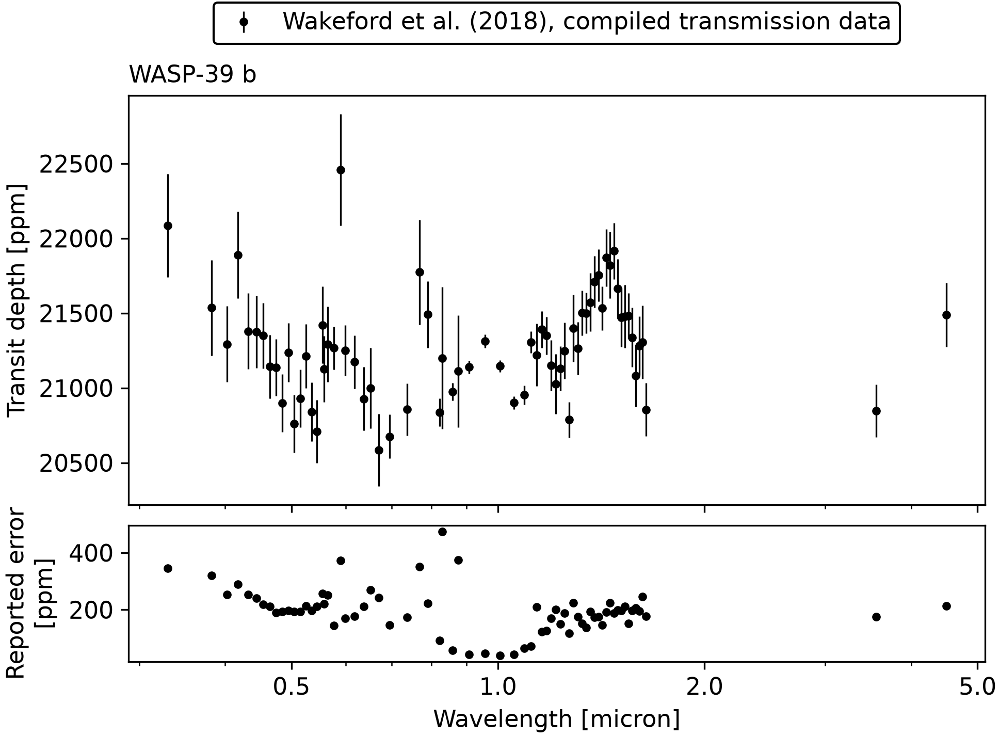
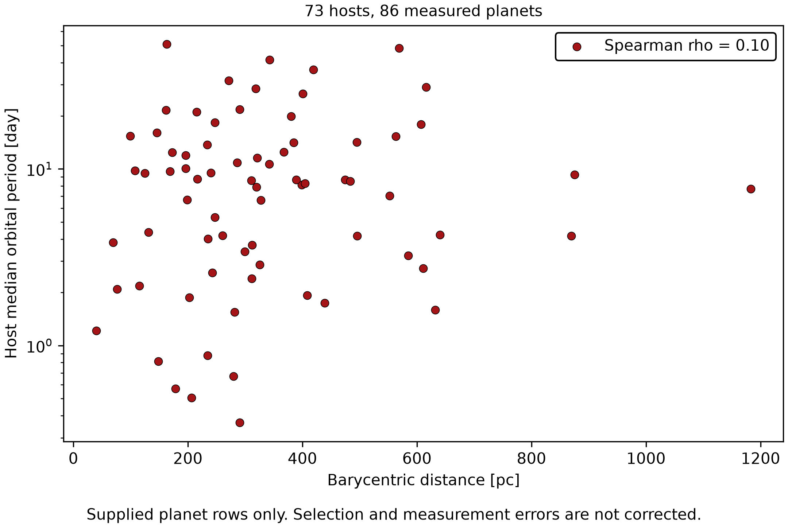
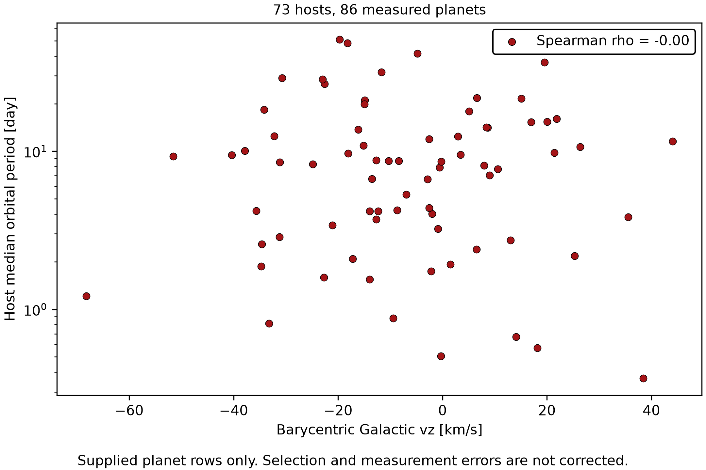
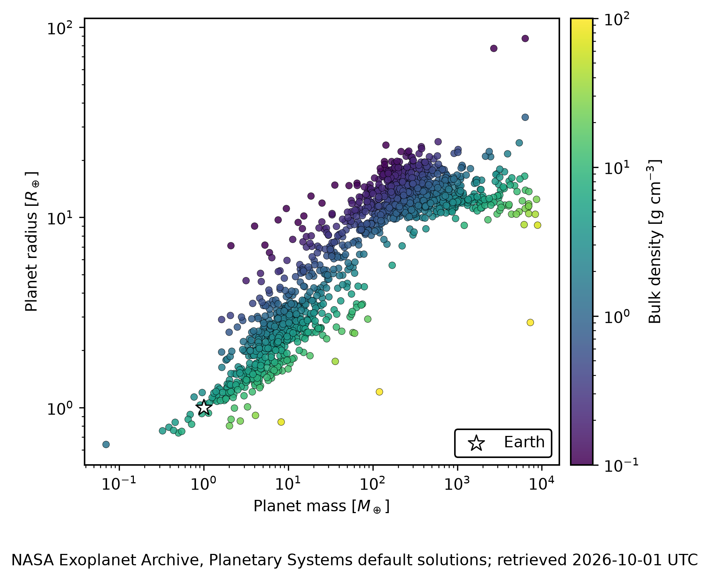
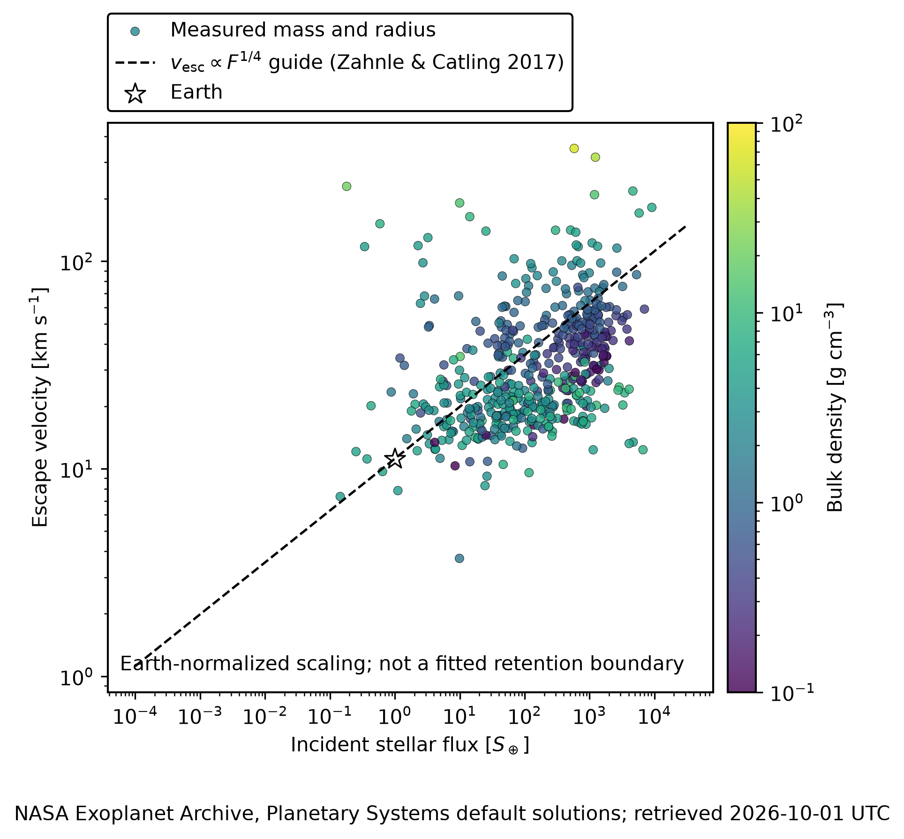
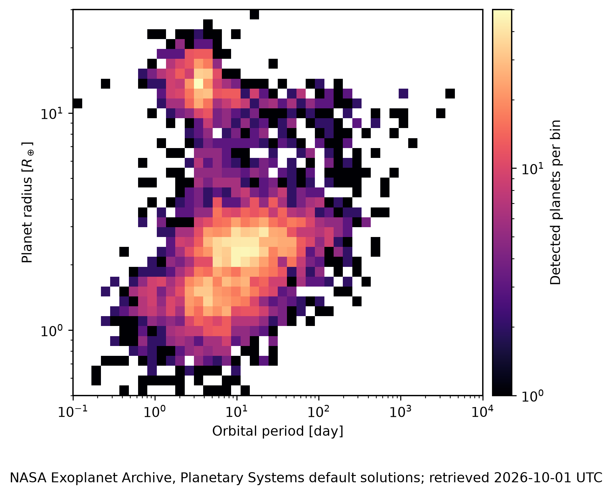

# Pergamon

The name refers to [Pergamon](https://en.wikipedia.org/wiki/Pergamon), the ancient city at modern Bergama, Turkey, known for its library. I use the name for a package that brings astronomical catalogs together and compares the populations they describe.

I use Pergamon when the question moves from one system to a population. How do the samples differ? Which quantities were measured, which were inferred, and which targets were never likely to be detected? A crowded scatter plot deserves a closer look at how the points got there.

## Purpose

Pergamon compares astrophysical samples, builds catalog tables, and makes their one- and two-dimensional distributions visible. I keep the measurement provenance and selection assumptions alongside those comparisons.

## Population analysis

Pass measured or inferred sample properties to the plotting functions. Occurrence calculations additionally need independently determined detection efficiencies. Counting the interesting objects is the easy part. Accounting for the ones the survey could have missed takes more work.

The compact-object, simulated-stellar-population, and synthetic-vetting
examples use white backgrounds with black axes. Pass `--typeplotback dark`
for black backgrounds with white axes in their static and interactive output.
Their Python plotting entry points accept `typeplotback='dark'` and otherwise
inherit an enclosing TDpy `plot_style()` theme.

## Exoplanet catalogs

Run `python -m pergamon.exoplanet_catalog` after setting `PERGAMON_PATH` to download current NASA Exoplanet Archive default planetary-system solutions. Pergamon writes UTC-tagged planet, host-system, all-pair, and neighboring-pair CSVs under `$PERGAMON_PATH/data/`. Existing snapshots are retained. Pass `--limit N` for a partial download. A partial host cannot establish whether an inner or outer companion is absent. Archive row URLs and retrieval times are included with each planet.

The planet table keeps published values and their limit flags. It adds Galactic coordinates from the measured sky position, a Keplerian semimajor axis, planetary Hill radius, Safronov number, and an eccentricity-only lower bound on angular-momentum deficit. These orbital quantities require reported true mass (`pl_masse`), not the archive's best mass (`pl_bmasse`, which may be a minimum mass). Null or upper/lower-limited inputs leave derived values blank. Invariant-plane inclinations are not supplied by the archive, so full angular-momentum deficit requires measured orbital orientations.

For host activity and stellar-wind quantities, supply independently measured CSV files using `--host-measurements` (`hostname`, `source_reference`, plus any of `host_xuv_luminosity_erg_s`, `host_convective_turnover_days`, `host_alfven_radius_stellar_radii`, and `host_flare_rate_per_day`). The supplied XUV luminosity and orbital scale yield XUV flux. Measured rotation and turnover periods yield Rossby number. An independently measured Alfvén radius is converted to astronomical units. Use `--orbital-orientations` (`pl_name`, `inclination_invariable_plane_deg`, `source_reference`) for full angular-momentum deficit. These values remain blank unless supported by measured inputs.

Host measurements and orbital orientations require nonblank source references.
Empty or whitespace-only references are rejected before quantities are derived.
Valid reference text is retained exactly as supplied.

Current archive downloads retain the stellar radius and rotation-period limit
flags. A reported bound therefore stays excluded from the derived Alfvén radius
or Rossby number, and nonfinite inputs leave the derived quantity blank.
Angular-momentum deficits use an equivalent expression that retains tiny
eccentricity and invariant-plane tilt contributions near circular, coplanar
orbits instead of losing them through subtraction of nearly equal values.

The system table lists confirmed planets by host. The pair table preserves every same-host pair and calculates mutual-Hill separations with Ephesos when true masses and orbital periods are available. The neighbor table includes only adjacent planets in complete, period-ordered systems. Planets with unknown order remain in the pair table without inferred inner/outer labels. Each pair row retains the stellar mass used to calculate its separation.

Derived calculations use finite measurements only. Infinite periods remain in
the raw archive columns, but cannot establish orbital order, prove a companion
absent, or make a system eligible for the complete-neighbor table. Known finite
pair orderings remain available even when another planet's period is unknown.

The archive supplies published transmission, eclipse, and direct-imaging spectrum counts. `pergamon.exoplanet_catalog.load_mast_spectra(planet_name)` retrieves a real Exo.MAST curated-spectra file list with file URLs. Additional source-identified atmosphere observations can be joined with `--atmosphere-observations` using `pl_name`, `source`, `observation_id`, and `source_url`. Unmatched names remain visible in the long-form observation table. Automatic ExoAtmospheres and MAST EAOT ingestion is not configured. Counts from those sources remain blank unless their records are supplied.

For curated files that explicitly label the four-column transmission format,
I can also read the measured spectrum through Exo.MAST's
[documented spectra API](https://exo.mast.stsci.edu/docs/spectra_ws.html).

```python
from pergamon.exoplanet_catalog import load_mast_transmission_spectrum

spectrum = load_mast_transmission_spectrum(
	"WASP-39 b", "WASP-39b_transmission_Wakeford2018.txt"
)
```

The columns are `wavelength_um`, `delta_wavelength_um`, `transit_depth`, and
`transit_depth_error`. Delta wavelength stays as reported, without assuming it
is a half-width or full bin width. Measured depths can be negative. Wavelengths
and reported uncertainties must be positive, delta wavelengths nonnegative,
and all values finite. Other headers and units are rejected rather than guessed.
The DataFrame's `attrs` retain the original response text and header, source URL,
planet and observation identifiers, UTC retrieval time, and response SHA-256.
This reader preserves the file's measurement order and publication notes.

I compare the measured depths with their reported errors on a shared logarithmic
wavelength axis. The varying precision matters when comparing different parts
of this compiled spectrum.

```python
from datetime import datetime, timezone
from pathlib import Path
from pergamon.exoplanet_catalog import plot_mast_transmission_spectrum

tag = datetime.now(timezone.utc).strftime("%Y%m%d_%H%M%S")
output = Path("examples/visuals") / f"wasp39b_transmission_{tag}.png"
plot_mast_transmission_spectrum(
	spectrum, output, source_label="Wakeford et al. (2018), compiled transmission data"
)
```

PNG output uses 300 dpi. Set `typefileplot="pdf"` for vector output and
`typeplotback="dark"` for a dark background. `font_size` defaults to 11 points
at the native 6.5-inch figure width and can be set to match the intended document.
Existing output files are preserved rather than overwritten.



WASP-39 b transmission measurements compiled in Wakeford et al. (2018), from
the [Exo.MAST source file](https://exo.mast.stsci.edu/api/v0.1/spectra/WASP-39%20b/file/WASP-39b_transmission_Wakeford2018.txt).
The original header also credits Fischer et al. (2016), Sing et al. (2016),
and Nikolov et al. (2016) for contributing observations. Both panels retain
all 70 reported rows, with reported uncertainties in the lower panel. The figure
contains no atmosphere model or estimate of feature significance.
[Dark PDF version](examples/visuals/wasp39b_wakeford2018_transmission_uncertainty_dark_20261026_230612.pdf).

Atmospheric record names, source identifiers, and URLs must contain non-whitespace
text. Observation IDs are unique within each source and planet. Identical
spectrum filenames for different planets are retained with their distinct source
URLs rather than treated as duplicate observations.

## Gaia host-star phase space

I match host stars to the Gaia DR3 `gaiadr3.gaia_source` table using the archive's exact DR3 identifiers. The archive reader preserves those identifiers as text. `load_gaia_dr3_astrometry` deduplicates requests, queries at most 100 identifiers per batch, and retains the query URL and UTC retrieval time with every returned row. Floating-point identifiers are rejected because converting a rounded ID back to an integer cannot recover the original star.

```python
from pergamon.exoplanet_catalog import load_confirmed_exoplanets
from pergamon.gaia_kinematics import load_gaia_dr3_astrometry, attach_gaia_phase_space

planets = load_confirmed_exoplanets(limit=20)
astrometry = load_gaia_dr3_astrometry(planets['gaia_dr3_id'])
hosts = attach_gaia_phase_space(planets, astrometry)
hosts[['pl_name', 'gaia_source_id', 'gaia_6d_status']]
```

The join retains every planet row, its order, its index, and the Gaia measurements even when complete phase space is unavailable. A shared host appears on each of its planet rows. The six Cartesian components require finite sky positions, proper motions, radial velocity, reference epoch, and positive parallax with positive uncertainty. I use inverse-parallax distances only when the fractional parallax error is at most 0.2. Pass a smaller `max_fractional_parallax_error` to tighten that cut. Missing radial velocities stay missing. `gaia_6d_status` distinguishes unmatched stars, incomplete measurements, invalid positions or parallaxes, and the precision cut.

Positions are in parsecs and velocities in km/s, along Galactic axes with the Solar System barycentre as the origin. Gaia's `pmra` includes the declination cosine. Coordinates remain at their reported reference epoch. No parallax zero-point correction, distance prior, covariance propagation, solar-motion subtraction, or Galactic potential is included. RUWE and radial-velocity uncertainty are retained without applying additional cuts. A 20-row download is only a usage example and carries no population selection correction.

The [Gaia comparison notebook](examples/gaia_host_correlations.ipynb) downloads a bounded 100-row archive excerpt and compares measured planet periods with host distance and vertical velocity. It runs `host_phase_space_rank_correlation` and `plot_host_phase_space_rank_correlation` from `pergamon.gaia_kinematics`. Each host contributes one median positive, non-limit planet measurement among its supplied rows. A star with several planets still contributes only one stellar coordinate. The helper also accepts measured planet radius or true mass and any of the six barycentric Galactic Cartesian components. Unsupported properties, conflicting host measurements, missing provenance, and duplicate planet names are rejected.

The returned table retains exact Gaia identifiers, measured-planet counts, and retrieval provenance. Fewer than three eligible hosts or constant values leave the coefficient undefined. The coefficient describes the supplied host medians without a p-value or an uncertainty estimate. Neither archive discovery selection nor Gaia radial-velocity selection is corrected. A bounded download can omit planets from a host, so its median need not describe a complete system. The notebook retains timestamped source and output CSVs under `data/`.

The plotting helper writes timestamped 300-dpi PNGs by default. Pass `typefileplot='pdf'`, `typeplotback='dark'`, or `write_bokeh=True` for vector, dark-theme, or self-contained interactive output. Static and Bokeh versions use the same host rows. Existing outputs are never overwritten. Host grouping and the rank calculation operate on the supplied rows, while network time depends on the number of distinct host IDs and TAP batches. The notebook shows descriptive associations only. Environmental measurements, corrected population correlations, Galactic trajectories, stellar encounters, and dynamical histories remain unimplemented.

For an exact local replay, set `PERGAMON_GAIA_SNAPSHOT_TAG` to a retained snapshot's timestamp before starting the notebook kernel. The notebook reads the corresponding `gaia_archive_planets_<timestamp>.csv` and `gaia_dr3_astrometry_<timestamp>.csv` under `data/`, preserving text identifiers and the original retrieval provenance. With no snapshot tag it queries the live archives. Source snapshots remain local. Replaying one writes newly timestamped results and leaves earlier outputs untouched.

The saved example uses 100 archive rows, with 86 eligible measured planet periods around 73 hosts. Its distance and vertical-velocity coefficients describe that excerpt only. The figures below retain the barycentric origin and make no population or dynamical-history claim.





Self-contained interactive versions show the same [distance comparison](examples/visuals/gaia_pl_orbper_gaia_inverse_parallax_distance_pc_white_20261024_004750.html) and [vertical-velocity comparison](examples/visuals/gaia_pl_orbper_gaia_barycentric_galactic_vz_km_s_white_20261024_004750.html).

## Dictionary catalogs and population synthesis

Nicomedia's catalog workflows now live in `pergamon.catalogs`. The retained adapters cover TIC8 target sets, TOI data, saved NASA Exoplanet Archive composite tables, host grouping, and TIC-to-TOI matching. They keep the historical `[values, unit_label]` dictionary format used by the analysis packages. New caches belong under `$PERGAMON_PATH/data/`. Existing saved inputs under `$EPHESOS_PATH/data/` can still be read when the corresponding Pergamon input is absent. The TOI adapter expects `exofop_toilists.csv`, and the historical archive adapter expects `PSCompPars_2023.10.12_16.58.05.csv`. These are supplied snapshots, not automatic current-catalog downloads. Use `pergamon.exoplanet_catalog` for the maintained live archive workflow.

`pergamon.emission_spectroscopy.calc_tsmmesmm` retains transmission and emission metric calculations for these dictionaries, including the existing optional sampling of input uncertainties. Missing planet temperatures or radii remain missing in the returned metrics. TDpy owns the numerical metric functions.

`pergamon.population_synthesis.retr_dictpoplstarcomp` preserves the inherited synthetic-system interface. With identical seeded inputs, the solar-like, one-planet path reproduced all 188 checked stellar and companion feature arrays and their unit labels from Nicomedia. Its chosen period, mass, distance, inclination, and multiplicity distributions are toy assumptions. The legacy moon, flare, and compact-object branches remain incomplete and should not be treated as validated physical populations. The generator uses NumPy's global random state, so set a seed explicitly for reproducible runs.

For mass-based synthetic stars, `radistar` sets a common radius in solar units.
It must be a finite positive real scalar. If omitted, the generator uses its
existing mass-dependent density relation.

```python
import numpy as np
from pergamon.population_synthesis import retr_dictpoplstarcomp

np.random.seed(42)
population = retr_dictpoplstarcomp(
	"PlanetarySystem", numbsyst=3, typesamporbtcomp="peripowr",
	minmpericomp=3.0, maxmpericomp=10.0, booltrancomp=True,
)
```

The original MIT notice remains in `LICENSE.Nicomedia`. TDpy owns shared profiles, spectra, noise prescriptions, and generic MAST requests. Chalcedon owns the lensing functions.

## Exoplanet demographics

The demographic plots accept `typeplotback='dark'` from Python or
`--typeplotback dark` from the module CLI. Their default is white backgrounds
with black axes. Python calls also inherit an enclosing TDpy theme.

Run `python -m pergamon.exoplanet_demographics` to query the full NASA Exoplanet Archive Planetary Systems table and write three publication-resolution figures under `visuals/exoplanet_demographics/`. Pass `--catalog path/to/exoplanet_planets.csv` to plot a retained catalog snapshot without a network request, or `--typefileplot pdf` for PDF output. The mass-radius diagram colors planets by bulk density. The cosmic-shoreline diagram plots measured escape speeds against reported incident flux and includes the Earth-normalized $v_{\rm esc} \propto F^{1/4}$ scaling discussed by Zahnle & Catling (2017). The diagram puts measured values in context. It does not fit an atmospheric-retention boundary or classify exoplanet atmospheres. The period-radius figure shows raw detected catalog counts. It does not apply a survey-completeness correction, so the counts cannot be interpreted as occurrence rates. Density and escape speed are calculated only from measured masses and radii. Archive limits are excluded from those calculations.







These figures use the 6,372-row archive snapshot retrieved on October 1, 2026.
Of those planets, 1,415 have positive, finite mass and radius measurements
that satisfy the archive limit flags. The shoreline legend sits outside the
measurements, and both scatter plots fit their axes to the supplied data.

The [demographics notebook](examples/exoplanet_demographics.ipynb) applies the same plotting function to a bounded live archive sample and saves its figures under `examples/visuals/`.

Each run writes UTC-timestamped filenames and preserves earlier figures. For a
chosen output timestamp, pass `--time-tag YYYYMMDD_HHMMSS` from the CLI or
`time_tag="YYYYMMDD_HHMMSS"` to `plot_exoplanet_demographics`. Reusing an existing
output timestamp raises an error before any figure is written.

## Atmospheric target prioritization

The emission spectroscopy metric (ESM) catalog workflow, transferred from Abydos, retrieves confirmed transiting planets from the NASA Exoplanet Archive composite planetary-system table. It passes the reported planet equilibrium temperature and radius, stellar temperature and radius, and host-star K magnitude to TDpy's `retr_esmm`. The composite table can combine parameters from different published solutions. The returned records retain finite positive metrics with their planet and host names.

```python
from pathlib import Path
from pergamon import fetch_esm_catalog, generate_esm_catalog_figure

records = fetch_esm_catalog()
generate_esm_catalog_figure(Path("visuals/archive_esm.png"))
```

Run the scatter-plot example or the metric-distribution alternative:

```bash
python examples/plot_archive_esm.py --typefileplot png
python examples/plot_archive_esm.py --distribution --typefileplot png
```

Both ESM plots accept `typeplotback='dark'` from Python. The example forwards
`--typeplotback dark` to either plot while retaining its catalog selection
and metric calculations.


The metric ranks relative observability under its assumed thermal-emission model. It cannot establish whether an atmosphere will be detected. `generate_esm_distribution_figure` preserves the catalog histogram from Abydos's older workflow. Its counts describe the selected archive sample. They are not occurrence rates. Use `--typefileplot pdf` for vector figures. These functions do not fit transit or radial-velocity observations. Miletos handles target-level time-series analysis.

## Candidate vetting

Sardis's workflow and classification summaries now live in `pergamon.vetting`. Use `pergamon.run_candidate_vetting(typesyst="PlanetarySystem", dictinpt=None, strgcnfg=None, pathbase=None)` in place of `sardis.init`. Pergamon's existing population-analysis `init` is unchanged. The vetting module also retains `init` and `retr_pathsard` aliases, along with the generic repository-path helpers.

The wrapper passes supplied `dictinpt` arguments unchanged to the population workflow, which prepares per-target Miletos calls. It preserves dictionary, attribute-object, and other return conventions. With no supplied dictionary, it uses TESS synthetic-target defaults. `vetting_paths` uses `PERGAMON_PATH` and creates configuration-specific `simulation` and `observed` directories beneath the selected base. Explicit `pathbase` and `strgcnfg` still work.

Existing callers can supply `dicttroiinpt` as an alias for `dictinpt`. Supply
only one of these arguments. The dictionary returned by `vetting_paths` retains
the historical `pathbasesard` key alongside `pathbasepergamon`.

`summarize_vetting_result` returns classifier labels, confusion matrices, precision, recall, and the positive-truth mask. Confusion matrices use rows for negative and positive truth, and columns for negative and positive decisions. Precision and recall remain zero when their denominator is zero. All prediction vectors must match the truth-label shape. Classification does not establish survey completeness or an occurrence rate.

Synthetic truth labels follow the actual generated class populations and target
indices. The summary rejects masked or nonfinite labels, fractional or
out-of-range class indices, ambiguous class names, and incomplete or nonbinary
predictions. Boolean, integer zero-or-one, floating zero-or-one, and fully
unmasked prediction arrays retain the same metrics.

Install the optional Miletos-backed workflow and run the example:

```bash
python -m pip install -e '.[vetting,bokeh]'
python examples/synthetic_vetting_performance.py --typefileplot png
python examples/synthetic_vetting_performance.py --typefileplot png --bokeh
```


The figure is a historical synthetic example from before the class-label
alignment checks. Running the script performs the current workflow for 100
simulated targets. Its updated full native result remains to be regenerated.
The example provides no estimate of performance on observed candidates.

## Occurrence rates

`pergamon.estimate_occurrence_rate(detected, detection_efficiency)` estimates the fraction of surveyed targets hosting an event. Provide one zero-or-one detection flag and one independently determined detection probability per target. For example, detections `[1, 0, 0]` and efficiencies `[1, 0.5, 0.5]` yield a maximum-likelihood occurrence fraction of about 0.67. These numbers illustrate the calculation and are not observational results. `pergamon.log_likelihood_occurrence_rate` evaluates the same model for posterior inference.

The calculation assumes at most one event per target, independent targets, known detection efficiencies, and no false positives. Classification alone does not establish detection efficiency. `pergamon.partition_classified_population` groups relevant and irrelevant targets by positive and negative classifications, including true and false positives and negatives, without inferring an occurrence rate from those groups.

For compact-object companion populations, Miletos derives Doppler-beaming, ellipsoidal-variation, and self-lensing amplitudes, along with transit duration, orbital scale, and Schwarzschild radius, through Ephesos. Pergamon reads these model-derived values for population-level comparisons and occurrence-rate estimation. They are not detections or measurements of survey completeness.

## Installation

```bash
cd pergamon
python -m pip install -e .
export PERGAMON_PATH=/path/to/pergamon
```

`PERGAMON_PATH` identifies the repository root. Keep runtime inputs in `data/` and generated outputs in `visuals/`. Git ignores both directories.

Install `python -m pip install -e '.[analysis]'` for optional Miletos-backed target analysis, or `python -m pip install -e '.[vetting]'` for candidate vetting. Population summaries, catalog adapters, and occurrence calculations do not require Miletos.

## Example workflow

The runnable example passes two deterministic simulated stellar samples through `pergamon.init(...)` and retains the pipeline's mass-radius comparison:

```bash
python examples/simulated_stellar_populations.py --typefileplot png
python examples/simulated_stellar_populations.py --typefileplot png --bokeh
```

Install `python -m pip install -e '.[bokeh]'` to also write an interactive mass-radius comparison.


Each sample contains 40 simulated stars. Reference masses span 0.75 to 1.15 solar masses, with radii set by $R_\star/R_\odot = 0.95(M_\star/M_\odot)+0.08$. Radius-enhanced masses span 0.95 to 1.45 solar masses, with $R_\star/R_\odot = 1.08(M_\star/M_\odot)+0.03$. `pergamon.init` plots the supplied mass-radius relations.

## Dependencies

The package uses:

- `numpy`
- `chalcedon`
- `pandas`
- `matplotlib`
- `tdpy`
- `ephesos`

## Output behavior

Pergamon produces marginal distributions, feature-pair comparisons, and population summary figures from measured or inferred sample properties.

