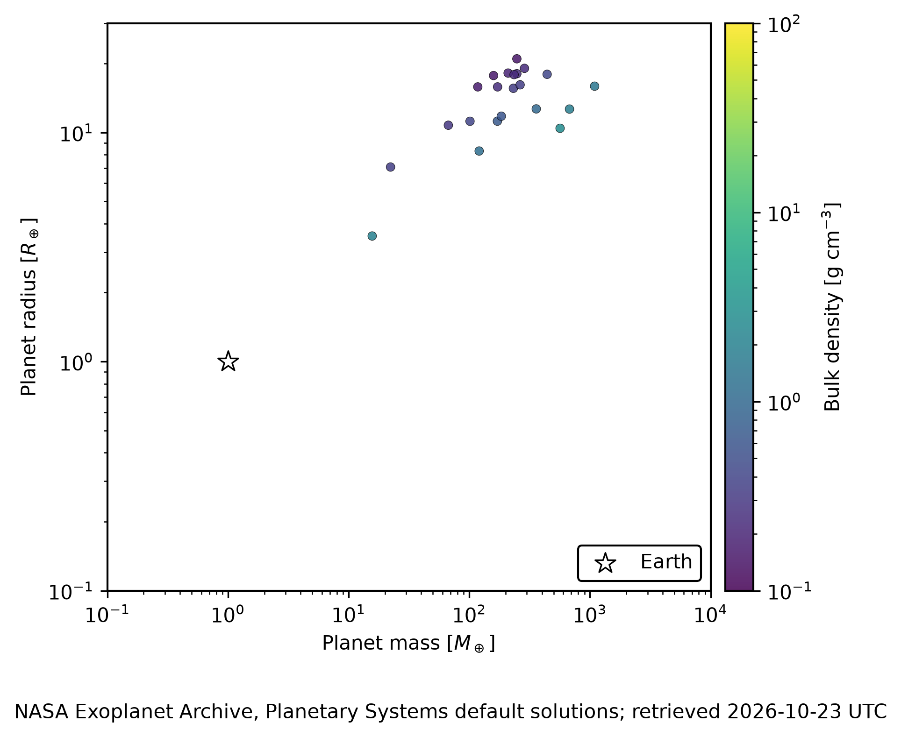
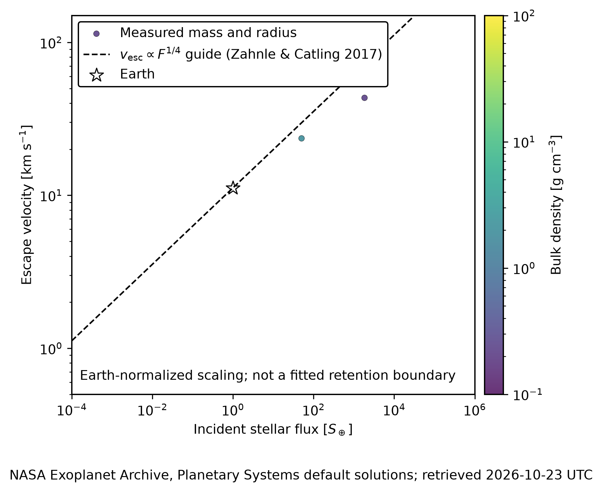
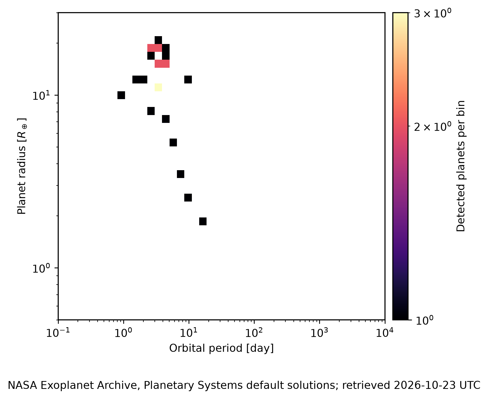
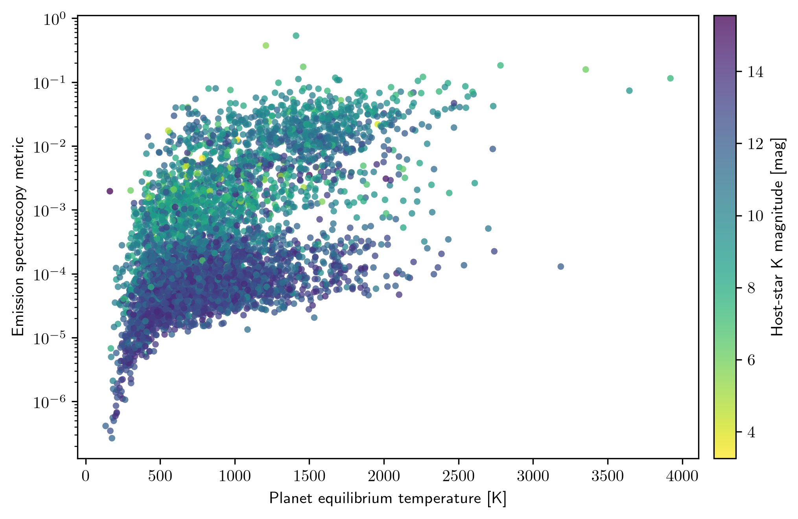
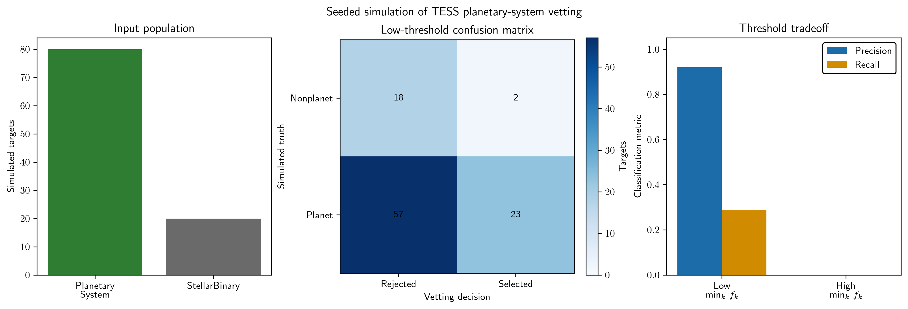
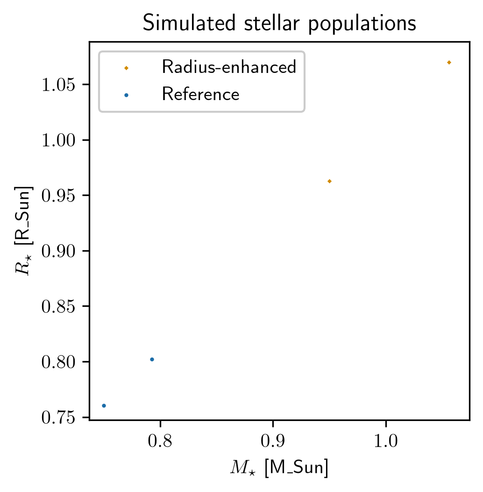

# Pergamon

I use Pergamon when the question moves from one system to a population. How do the samples differ? Which quantities were measured, which were inferred, and which targets were never likely to be detected? A crowded scatter plot deserves a closer look at how the points got there.

## Purpose

Pergamon compares astrophysical samples, builds catalog tables, and makes their one- and two-dimensional distributions visible. I keep the measurement provenance and selection assumptions alongside those comparisons.

## Population analysis

Pass measured or inferred sample properties to the plotting functions. Occurrence calculations additionally need independently determined detection efficiencies. Counting the interesting objects is the easy part. Accounting for the ones the survey could have missed takes more work.

The compact-object, simulated-stellar-population, and synthetic-vetting
examples use white backgrounds with black axes. Pass `--typeplotback dark`
for black backgrounds with white axes in their static and interactive output.
Their Python plotting entry points accept `typeplotback='dark'` and otherwise
inherit an enclosing TDpy `plot_style()` theme.

## Exoplanet catalogs

Run `python -m pergamon.exoplanet_catalog` after setting `PERGAMON_PATH` to download current NASA Exoplanet Archive default planetary-system solutions. Pergamon writes UTC-tagged planet, host-system, all-pair, and neighboring-pair CSVs under `$PERGAMON_PATH/data/`. Existing snapshots are retained. Pass `--limit N` for a partial download. A partial host cannot establish whether an inner or outer companion is absent. Archive row URLs and retrieval times are included with each planet.

The planet table keeps published values and their limit flags. It adds Galactic coordinates from the measured sky position, a Keplerian semimajor axis, planetary Hill radius, Safronov number, and an eccentricity-only lower bound on angular-momentum deficit. These orbital quantities require reported true mass (`pl_masse`), not the archive's best mass (`pl_bmasse`, which may be a minimum mass). Null or upper/lower-limited inputs leave derived values blank. Invariant-plane inclinations are not supplied by the archive, so full angular-momentum deficit requires measured orbital orientations.

For host activity and stellar-wind quantities, supply independently measured CSV files using `--host-measurements` (`hostname`, `source_reference`, plus any of `host_xuv_luminosity_erg_s`, `host_convective_turnover_days`, `host_alfven_radius_stellar_radii`, and `host_flare_rate_per_day`). The supplied XUV luminosity and orbital scale yield XUV flux. Measured rotation and turnover periods yield Rossby number. An independently measured Alfvén radius is converted to astronomical units. Use `--orbital-orientations` (`pl_name`, `inclination_invariable_plane_deg`, `source_reference`) for full angular-momentum deficit. These values remain blank unless supported by measured inputs.

The system table lists confirmed planets by host. The pair table preserves every same-host pair and calculates mutual-Hill separations with Ephesos when true masses and orbital periods are available. The neighbor table includes only adjacent planets in complete, period-ordered systems. Planets with unknown order remain in the pair table without inferred inner/outer labels. Each pair row retains the stellar mass used to calculate its separation.

The archive supplies published transmission, eclipse, and direct-imaging spectrum counts. `pergamon.exoplanet_catalog.load_mast_spectra(planet_name)` retrieves a real Exo.MAST curated-spectra file list with file URLs. Additional source-identified atmosphere observations can be joined with `--atmosphere-observations` using `pl_name`, `source`, `observation_id`, and `source_url`. Unmatched names remain visible in the long-form observation table. The catalog does not automatically download ExoAtmospheres or MAST EAOT records because neither offers a stable machine-readable export. Counts from those sources remain blank unless their records are supplied.

## Dictionary catalogs and population synthesis

Nicomedia's catalog workflows now live in `pergamon.catalogs`. The retained adapters cover TIC8 target sets, TOI data, saved NASA Exoplanet Archive composite tables, host grouping, and TIC-to-TOI matching. They keep the historical `[values, unit_label]` dictionary format used by the analysis packages. New caches belong under `$PERGAMON_PATH/data/`. Existing saved inputs under `$EPHESOS_PATH/data/` can still be read when the corresponding Pergamon input is absent. The TOI adapter expects `exofop_toilists.csv`, and the historical archive adapter expects `PSCompPars_2023.10.12_16.58.05.csv`. These are supplied snapshots, not automatic current-catalog downloads. Use `pergamon.exoplanet_catalog` for the maintained live archive workflow.

`pergamon.emission_spectroscopy.calc_tsmmesmm` retains transmission and emission metric calculations for these dictionaries, including the existing optional sampling of input uncertainties. Missing planet temperatures or radii remain missing in the returned metrics. TDpy owns the numerical metric functions.

`pergamon.population_synthesis.retr_dictpoplstarcomp` preserves the inherited synthetic-system interface. With identical seeded inputs, the solar-like, one-planet path reproduced all 188 checked stellar and companion feature arrays and their unit labels from Nicomedia. Its chosen period, mass, distance, inclination, and multiplicity distributions are toy assumptions. The legacy moon, flare, and compact-object branches remain incomplete and should not be treated as validated physical populations. The generator uses NumPy's global random state, so set a seed explicitly for reproducible runs.

```python
import numpy as np
from pergamon.population_synthesis import retr_dictpoplstarcomp

np.random.seed(42)
population = retr_dictpoplstarcomp(
	"PlanetarySystem", numbsyst=3, typesamporbtcomp="peripowr",
	minmpericomp=3.0, maxmpericomp=10.0, booltrancomp=True,
)
```

The original MIT notice remains in `LICENSE.Nicomedia`. TDpy owns shared profiles, spectra, noise prescriptions, and generic MAST requests. Chalcedon owns the lensing functions.

## Exoplanet demographics

The demographic plots accept `typeplotback='dark'` from Python or
`--typeplotback dark` from the module CLI. Their default is white backgrounds
with black axes. Python calls also inherit an enclosing TDpy theme.

Run `python -m pergamon.exoplanet_demographics` to query the full NASA Exoplanet Archive Planetary Systems table and write three publication-resolution figures under `visuals/exoplanet_demographics/`. Pass `--catalog path/to/exoplanet_planets.csv` to plot a retained catalog snapshot without a network request, or `--typefileplot pdf` for PDF output. The mass-radius diagram colors planets by bulk density. The cosmic-shoreline diagram plots measured escape speeds against reported incident flux and includes the Earth-normalized $v_{\rm esc} \propto F^{1/4}$ scaling discussed by Zahnle & Catling (2017). The diagram puts measured values in context. It does not fit an atmospheric-retention boundary or classify exoplanet atmospheres. The period-radius figure shows raw detected catalog counts. It does not apply a survey-completeness correction, so the counts cannot be interpreted as occurrence rates. Density and escape speed are calculated only from measured masses and radii. Archive limits are excluded from those calculations.







The [demographics notebook](examples/exoplanet_demographics.ipynb) applies the same plotting function to a bounded live archive sample and saves its figures under `examples/visuals/`.

## Atmospheric target prioritization

The emission spectroscopy metric (ESM) catalog workflow, transferred from Abydos, retrieves confirmed transiting planets from the NASA Exoplanet Archive composite planetary-system table. It passes the reported planet equilibrium temperature and radius, stellar temperature and radius, and host-star K magnitude to TDpy's `retr_esmm`. The composite table can combine parameters from different published solutions. The returned records retain finite positive metrics with their planet and host names.

```python
from pathlib import Path
from pergamon import fetch_esm_catalog, generate_esm_catalog_figure

records = fetch_esm_catalog()
generate_esm_catalog_figure(Path("visuals/archive_esm.png"))
```

Run the scatter-plot example or the metric-distribution alternative:

```bash
python examples/plot_archive_esm.py --typefileplot png
python examples/plot_archive_esm.py --distribution --typefileplot png
```

Both ESM plots accept `typeplotback='dark'` from Python. The example forwards
`--typeplotback dark` to either plot while retaining its catalog selection
and metric calculations.



The metric ranks relative observability under its assumed thermal-emission model. It cannot establish whether an atmosphere will be detected. `generate_esm_distribution_figure` preserves the catalog histogram from Abydos's older workflow. Its counts describe the selected archive sample. They are not occurrence rates. Use `--typefileplot pdf` for vector figures. These functions do not fit transit or radial-velocity observations. Miletos handles target-level time-series analysis.

## Candidate vetting

Sardis's workflow and classification summaries now live in `pergamon.vetting`. Use `pergamon.run_candidate_vetting(typesyst="PlanetarySystem", dictinpt=None, strgcnfg=None, pathbase=None)` in place of `sardis.init`. Pergamon's existing population-analysis `init` is unchanged. The vetting module also retains `init` and `retr_pathsard` aliases, along with the generic repository-path helpers.

The workflow passes supplied `dictinpt` arguments unchanged to Miletos and preserves dictionary, attribute-object, and other return conventions. With no supplied dictionary, it uses TESS synthetic-target defaults. `vetting_paths` uses `PERGAMON_PATH` and creates configuration-specific `simulation` and `observed` directories beneath the selected base. Explicit `pathbase` and `strgcnfg` still work.

Existing callers can supply `dicttroiinpt` as an alias for `dictinpt`. Supply
only one of these arguments. The dictionary returned by `vetting_paths` retains
the historical `pathbasesard` key alongside `pathbasepergamon`.

`summarize_vetting_result` returns classifier labels, confusion matrices, precision, recall, and the positive-truth mask. Confusion matrices use rows for negative and positive truth, and columns for negative and positive decisions. Precision and recall remain zero when their denominator is zero. All prediction vectors must match the truth-label shape. Classification does not establish survey completeness or an occurrence rate.

Install the optional Miletos-backed workflow and run the example:

```bash
python -m pip install -e '.[vetting,bokeh]'
python examples/synthetic_vetting_performance.py --typefileplot png
python examples/synthetic_vetting_performance.py --typefileplot png --bokeh
```



The figure shows a synthetic candidate-vetting summary, not the result of a fresh posterior run. Running the script can perform posterior inference for 100 synthetic targets, so it is not a lightweight preview. These results do not describe observed-candidate performance.

## Occurrence rates

`pergamon.estimate_occurrence_rate(detected, detection_efficiency)` estimates the fraction of surveyed targets hosting an event. Provide one zero-or-one detection flag and one independently determined detection probability per target. For example, detections `[1, 0, 0]` and efficiencies `[1, 0.5, 0.5]` yield a maximum-likelihood occurrence fraction of about 0.67. These numbers illustrate the calculation and are not observational results. `pergamon.log_likelihood_occurrence_rate` evaluates the same model for posterior inference.

The calculation assumes at most one event per target, independent targets, known detection efficiencies, and no false positives. Classification alone does not establish detection efficiency. `pergamon.partition_classified_population` groups relevant and irrelevant targets by positive and negative classifications, including true and false positives and negatives, without inferring an occurrence rate from those groups.

For compact-object companion populations, Miletos derives Doppler-beaming, ellipsoidal-variation, and self-lensing amplitudes, along with transit duration, orbital scale, and Schwarzschild radius, through Ephesos. Pergamon reads these model-derived values for population-level comparisons and occurrence-rate estimation. They are not detections or measurements of survey completeness.

## Installation

```bash
cd pergamon
python -m pip install -e .
export PERGAMON_PATH=/path/to/pergamon
```

`PERGAMON_PATH` identifies the repository root. Keep runtime inputs in `data/` and generated outputs in `visuals/`. Git ignores both directories.

Install `python -m pip install -e '.[analysis]'` for optional Miletos-backed target analysis, or `python -m pip install -e '.[vetting]'` for candidate vetting. Population summaries, catalog adapters, and occurrence calculations do not require Miletos.

## Example workflow

The runnable example passes two deterministic simulated stellar samples through `pergamon.init(...)` and retains the pipeline's mass-radius comparison:

```bash
python examples/simulated_stellar_populations.py --typefileplot png
python examples/simulated_stellar_populations.py --typefileplot png --bokeh
```

Install `python -m pip install -e '.[bokeh]'` to also write an interactive mass-radius comparison.



The reference sample spans 0.75 to 1.15 solar masses. The radius-enhanced sample spans 0.95 to 1.45 solar masses and follows a steeper deterministic mass-radius relation. Both populations are simulated inputs rather than observed stars. Pergamon constructs the common feature matrix and produces the displayed comparison through its standard population-plotting pipeline.

## Dependencies

The package uses:

- `numpy`
- `chalcedon`
- `pandas`
- `matplotlib`
- `tdpy`
- `ephesos`

## Output behavior

Pergamon produces marginal distributions, feature-pair comparisons, and population summary figures from measured or inferred sample properties.

